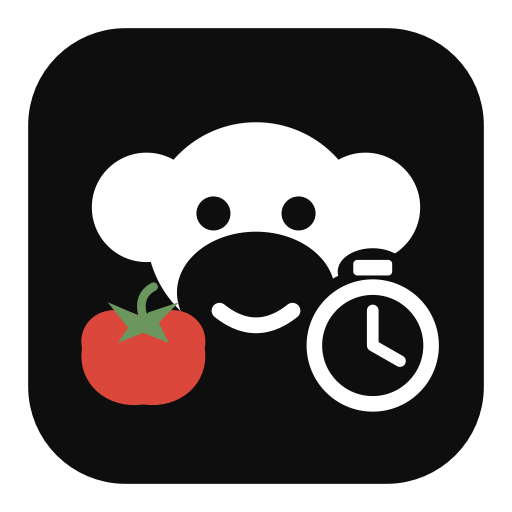

# Chimpodoro

A lightweight native Pomodoro timer for macOS, with a menu-bar timer, a resizable
desktop window, and synchronized study parties.



## Features

- Focus, short-break, and long-break timers with pause, resume, reset, and skip.
- Persistent completion card with an explicit next-session button.
- Optional task, completion sound, notifications, and launch at login.
- Desktop timer you can move to another display or keep above other windows.
- Custom chimp colors and accessories.
- Internet parties for up to eight people, joined with a shared code. The host
  controls one synchronized timer; members see each other's chimps.

Requires macOS 14 or later. The supplied build scripts compile for the current
Mac's architecture. Apple Command Line Tools are required to build.

## Build and run

```sh
./build.sh
open build/Chimpodoro.app
```

To install in `~/Applications`:

```sh
./build.sh --install --open
```

Quit Chimpodoro before replacing a running copy. Builds are ad-hoc signed for
local use; they are not Apple-notarized releases.

## Use

Click the menu-bar chimp to open the timer. Use the window button or **⌘D** for
the desktop timer. **Space** starts or pauses, **⌘R** resets, **⌘→** skips, and
**⌘,** opens settings. Shortcuts apply while Chimpodoro is active.

The defaults are 25 minutes of focus, a 5-minute short break, and a 15-minute long
break after four completed focus sessions. Automatic starts are off by default.
Closing a window leaves the timer running. A saved deadline keeps it accurate
across sleep and relaunch. Skipped or reset sessions receive no completion credit.

Choose **Customize chimp…** to edit your appearance. Choose **Create / join party…**
to create a party or enter a friend's code. Version 1.1.1 includes the public
party-service address; guests do not need a Cloudflare account or a server.

Joining pauses and preserves your solo timer. Leaving restores it. Only the host
controls the shared timer. Host departure ends the party; disconnected members
can reconnect. Parties expire after 24 hours. Party sessions do not count toward
personal daily totals in this version. Leaderboards are not implemented.

## Resource use and privacy

One Swift/AppKit executable, native vector artwork, and no bundled runtime,
webview, analytics, or third-party app dependencies. Countdown refreshes happen
once per second while visible and at minute boundaries when hidden. Idle or
paused solo timers have no refresh timer. Party mode uses one system WebSocket
with a 30-second connection/clock check. Windows and unchanged avatars are reused.

Solo preferences, task text, timer state, and up to 30 active dates of focus totals
stay on the Mac. Party members share display names, cosmetic choices, membership,
and timer state with the configured service; personal task text and solo history
are not uploaded. Membership credentials are stored in Keychain. Server party
data expires after 24 hours or when the host ends the party.

The default service uses Cloudflare's free tier and is subject to its quotas;
it is not an availability guarantee. You can run your own service by following
[Server/README.md](Server/README.md). Set a custom HTTPS address through
**Create / join party → Service…**. Every member must use the same service.

## Tests and packaging

```sh
./test.sh
./package.sh
```

The timer suite covers transitions, completion accounting, persistence, and
sleep/relaunch recovery. Server tests and two-client integration instructions
are in [Server/README.md](Server/README.md). Live integration has exercised shared
deadlines, host authority, revision checks, profile changes, reconnects, and a real
completion alarm. Two physical Macs on separate networks remain to be verified.

Packaging writes a ZIP and SHA-256 checksum under `build/release/`. The app's
runtime has no dependency on the server's development tools or `node_modules`.

## Artwork

The chimp geometry comes from the ChimpRace family mark. The stopwatch overlays
the lower-right edge; the tomato appears only in the app icon. Glasses follow the
ChimpRead frame design. Regenerate the icon with `./make-icon.sh`.
